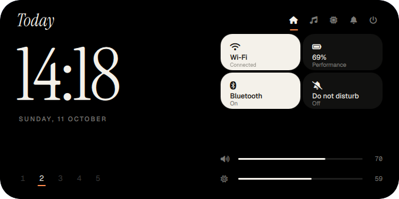
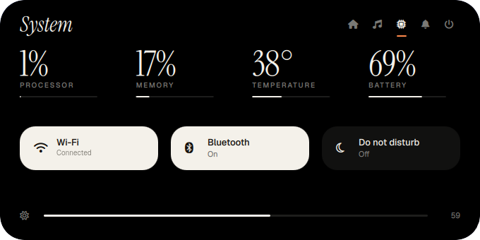
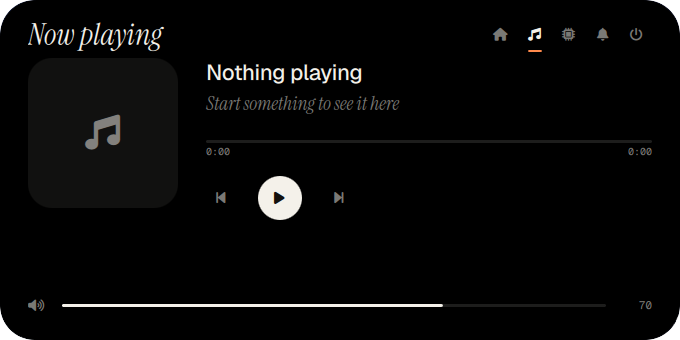
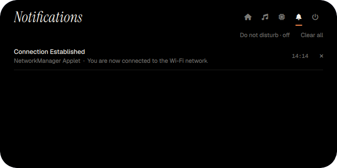

<h1 align="center">ddmm</h1>
<p align="center"><i>A desktop that is only a Dynamic Island.</i><br>
Quickshell · Hyprland · no bar, no dock, no widgets</p>

<p align="center">
  
  
</p>

One black pill sits at the top of the screen. Hover it and it springs open into a small
carousel of pages; the launcher, wallpaper picker, lock screen, notifications and volume /
brightness OSD are all the same pill morphing into something else.

## Features

- **Hover to grow.** Spring-animated pill. Two-finger touchpad swipes follow your fingers and snap to a page; mouse wheel moves one page per notch; `1`-`5` / `Tab` also work.
- **Pages:** Home (clock, Wi-Fi / Bluetooth / DND tiles, volume, brightness) · Media (MPRIS) · System (CPU, RAM, temp, battery) · Notifications · Power.
- **Spotlight-style launcher** (`SUPER+Space`): apps ranked by frecency, open-window switcher, calculator and unit conversion (`5km to mi`, `20% of 80`), `>` run a command, `f ` files via `fd`, `v ` clipboard history via `cliphist`, web search fallback.
- **Wallpaper picker** (`SUPER+G`): type a colour (`blue`, `dark`, `mavi`...) to filter, arrows to browse, applies with a grow transition via `awww`.
- **Lock screen** (`SUPER+L` or lid close): the pill drops to the centre, shows clock / now playing / battery, turns into a password field as you type, and glides back on unlock. PAM through the `hyprlock` service.
- **Live activities:** workspace changes, track changes and charger plug-in flash in the idle pill without hovering.
- **Notifications daemon** built in (it takes over from dunst), with a toast that morphs the pill.
- Everything is tweakable from the terminal: `ddmm list`, `ddmm set accent=#7aa2ff`, `ddmm set openWidth=720`.

<p align="center">
  
  
</p>

## Install

```sh
git clone https://github.com/davidovicbtw/ddmm
cd ddmm
./install.sh
```

The installer checks dependencies (and prints the exact package command for your distro),
installs the shell to `~/.config/quickshell/ddmm`, the CLI to `~/.local/bin`, downloads the
fonts (Geist, Geist Mono, Instrument Serif; all SIL OFL) and drops keybind snippets in
`~/.config/ddmm/hypr/`. It never edits your Hyprland config and backs up anything it replaces.

Then hook it up:

```lua
-- hyprland.lua
dofile(os.getenv("HOME") .. "/.config/ddmm/hypr/ddmm.lua")
```
```ini
# hyprland.conf
source = ~/.config/ddmm/hypr/ddmm.conf
```

Remove other bars (waybar, ags, ...) from your autostart, then run `ddmm run`.

`./install.sh --link` symlinks instead of copying (handy for hacking), `--check` only checks
dependencies, `--uninstall [--purge]` removes everything.

### Dependencies

| Required | Used for |
|---|---|
| `quickshell` (git, 0.3+) | the shell |
| `hyprland` | workspaces, windows, keybinds |
| `awww` | wallpaper transitions |
| `python` | the `ddmm` CLI |

Optional: `hyprlock` (PAM service for the lock screen), `cliphist` + `wl-clipboard`, `fd`,
`brightnessctl`, `pipewire` (`pw-play` sounds), `networkmanager`, `bluez`,
`power-profiles-daemon`, `python-pillow`, `kitty` (change with `ddmm set terminal=foot`).

## Keys

| | |
|---|---|
| `SUPER+Space` | launcher |
| `SUPER+S` | toggle the island |
| `SUPER+G` | wallpapers |
| `SUPER+K` | power |
| `SUPER+L` | lock |
| `SUPER+V` | clipboard history |

## CLI

```
ddmm run | stop | restart | status
ddmm island open|close|toggle|page <n|name>
ddmm launcher [query] | wallpaper | power | media | lock
ddmm lockdemo           # preview the lock screen in a window, Esc leaves
ddmm set key=value ... | get | list | reset
```

Settings live in `~/.config/ddmm/settings.json` (accent colour, sizes, 24h clock, scroll
direction, swipe sensitivity, sounds, wallpaper folder...). `ddmm list` shows them all.

## Notes

- Tested on Arch with Hyprland 0.56 and Quickshell 0.3.1 (git). Other setups: please open an issue.
- The lock screen has been used in anger on one machine. Use `ddmm lockdemo` first, and know that `hyprlock` from a TTY is your way out if something goes wrong.
- The touchpad feel is tuned on one laptop; `ddmm set swipeDistance=...` if it feels too sluggish or twitchy.

## License

MIT. Fonts are SIL OFL and downloaded from [google/fonts](https://github.com/google/fonts) at install time.
